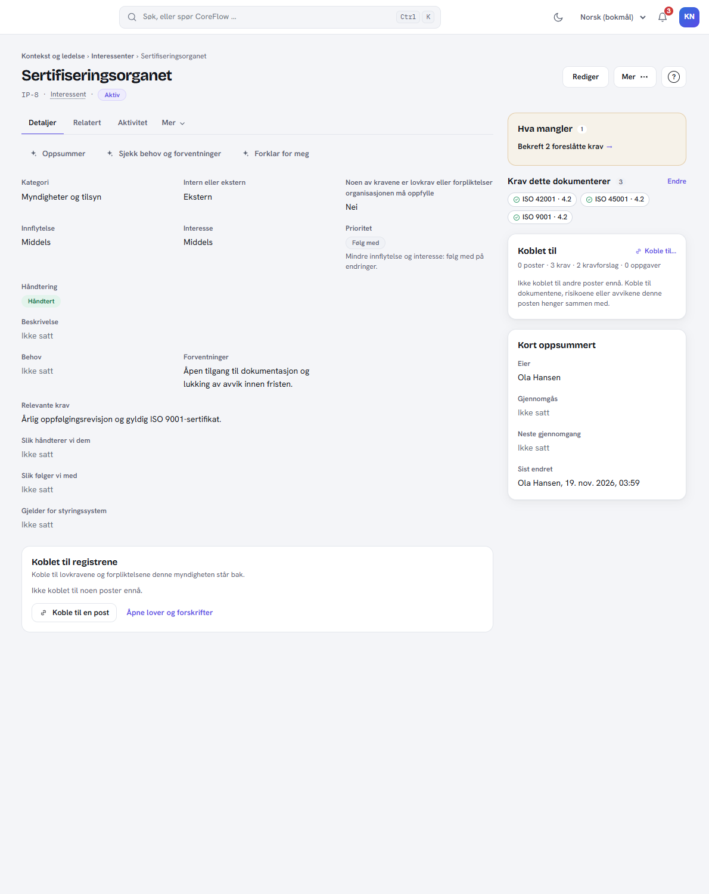
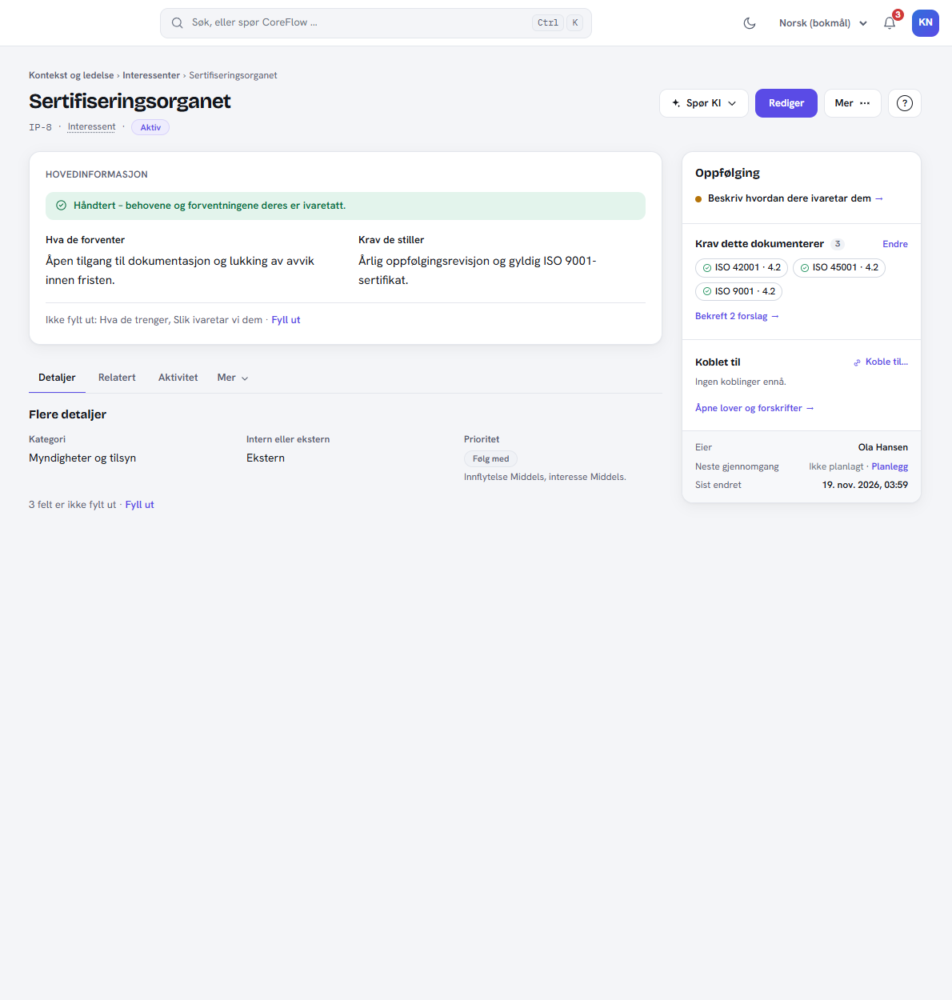
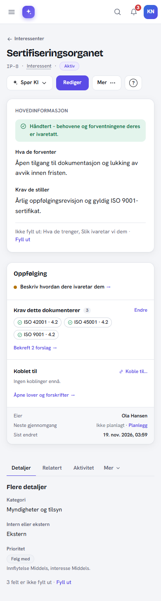

# CoreFlow UX guide

The single reference for how a CoreFlow page is built and how it speaks. Every area
item (A01-A26) follows it. Source decisions: `docs/polish-plan.md` §2.4 and §3,
`cf-test/polish-audit/design.md` §6.

Contents

1. Principles
2. Page anatomy (list, detail, form, overview, settings, detail-page anatomy)
3. Shared components (`src/app/shared/ui`)
4. Design tokens
5. Tone map (status and severity colours)
6. Writing guide (10 rules)
7. Glossary (nb)
8. Navigation and information architecture
9. Mobile and accessibility rules
10. Before / after examples
11. Area checklist (short form)

---

## 1. Principles

- **One page anatomy.** Every page is built from the same parts in the same order, so a
  user who knows one module knows all of them.
- **Plain language first.** CoreFlow is used by beginners and by auditors. Write for the
  beginner; the expert reads faster when the words are plain too.
- **Evidence and teaching look different.** A real link from a record to a requirement is
  an outlined chip with a status icon (`app-requirement-chip`, P1). Teaching ("why it
  matters") is a text link inside the explanation. Never pills that look alike.
- **Green means done.** Low risk is not an achievement (neutral, not green). Low coverage is
  a to-do (never red).
- **Nothing raw reaches the user.** No enum values, internal refs, field keys, `**markdown**`
  or English catalogue titles in the nb UI.

## 2. Page anatomy

Page padding is `px-4 sm:px-8`, `pt-6 sm:pt-7`, `pb-12`, max width 1180 px. Sections are
`gap-6`; cards are `p-5`.

### 2.1 Every module page

```
app-page-header      breadcrumbs (Module › Sub-area › Record)
                     h1 (= nav label on module roots: modules.names.<key>)
                     one-line description
                     actions, right: [secondary] (≤ 2) · [primary] (1) · "Mer ⋯" [overflow] · ⚙ settingsLink
app-module-nav       sub-pages as underline tabs, directly under the header (all pages visible; scrolls)
app-help-strip       intro + Omvisning + Leksjon · N min + Forklar denne siden (one row)
…page content…
```

- The h1 of a module root is `modules.names.<key>` in the global files. The nav uses the
  same key, and so does the first breadcrumb. Never write the module name anywhere else.
- At most **one primary** action, **two secondary** actions, the rest in "Mer ⋯".
  **Delete is only in the overflow menu**, as `appMenuItem [danger]="true"`, and always asks
  with `app-confirm-dialog`.
- `app-page-header` also sets the browser tab: "`<h1>` · CoreFlow".
- Learning lives **only** in `app-help-strip`. No other tour, lesson or "teach me" buttons
  on the page. Why-it-matters goes **below** the list (`[below]` slot), collapsed for
  non-beginners.

### 2.2 List page

Use `app-record-list-page`:

```
app-page-header  (titleKey, descriptionKey, breadcrumbs, settingsLink; [primary] [secondary] [overflow])
[nav]            app-module-nav
[help]           app-help-strip
[kpis]           app-kpi-band "Nøkkeltall": collapsible, ≤ 4 app-kpi-tile (more behind "Vis alle (N)")
toolbar          search · [filters] (≤ 2 visible) · "Flere filtre" ([more-filters]) · saved views
list             app-record-row-header + app-record-row … (or a table with the same columns)
[empty]          app-teaching-empty with the same CTA words as the primary button
[below]          app-why-it-matters
```

- `app-record-row` columns: **code** (mono, `text-meta`) · **title** + subtitle ·
  **[coverage]** (`app-coverage-chip`, P1) · **[badges]** (status first, then severity) ·
  **owner** · **date** (`dateKind`: due / updated / created / next / date; `overdue` turns it
  amber and adds "Forfalt").
- Column headers (`app-record-row-header`) show from 1024 px. Below 640 px the row stacks.
- A column that no row in the list fills (no coverage, owner or date anywhere) collapses
  so the title gets the room; header and rows stay aligned (needs the `role="list"` wrapper).
  Badges stay on one line from 1024 px; what does not fit shows as "+N" (tooltip lists them).
- Wrap the rows in an element with `role="list"`; the whole row is clickable.
- U30 "list diet": search plus **two** filters chosen per register; everything else (sort,
  "mine", secondary dimensions) goes into `[more-filters]`. Pass `moreFiltersActive` so the
  button says "Flere filtre (2)".
- **All main pages in a module are visible tabs; overflow scrolls, it never hides pages behind
  "Mer".** `app-module-nav` scrolls sideways with fade edges when the row is too narrow and keeps
  the current tab in view. "Mer" holds actions and rarely used settings only. Overview first,
  then the main registers; keep labels short. Mark a tab
  `empty: true` when it has no records: beginners do not see it (unless it is open).
- Key-figure tiles go in `app-kpi-band` (the list frame does this for `[kpis]`; overview pages
  use it directly). It shows four tiles, the most useful first; the user can collapse it
  (remembered per page) or open "Vis alle (N)".
- While loading: `app-loading-state [rows]="5"`. On error: `app-error-state (retry)`.
  An empty filter result (not an empty register): `app-empty-state` with
  `ui.empty.noResults` and "Fjern filtrene".

**List page snippet (copy this)**

```html
<app-record-list-page
  titleKey="modules.names.x"
  descriptionKey="x.list.description"
  scope="x"
  [breadcrumbs]="[{ labelKey: 'modules.names.x' }]"
  settingsLink="/settings/modules/x"
  [query]="q()"
  [filters]="{ status: status() }"
  [moreFiltersActive]="moreActive()"
  [empty]="state() === 'ready' && rows().length === 0 && !filtered()"
  (search)="q.set($event)"
  (viewApplied)="applyView($event)"
>
  <app-button primary (click)="create()">{{ 'x.actions.new' | transloco }}</app-button>
  <app-module-nav nav [items]="nav" />
  <app-help-strip help scope="x" page="list" />
  <select filters aria-label="…" class="h-9 rounded-tile border border-border bg-bg px-3 text-ui">
    …
  </select>
  <div more-filters>…</div>

  @switch (state()) { @case ('loading') { <app-loading-state [rows]="5" /> } @case ('error') {
  <app-error-state (retry)="reload()" /> } @default { @if (rows().length) {
  <app-record-row-header />
  <div role="list">
    @for (r of rows(); track r.id) {
    <app-record-row [link]="['/x', r.id]" [code]="r.code" [title]="r.title" … />
    }
  </div>
  } @else {
  <app-empty-state kind="filtered" (cta)="clearFilters()" />
  } } }
  <app-teaching-empty empty … />
  <app-why-it-matters below scope="x" page="list" />
</app-record-list-page>
```

Rules: one primary action (same words as the form title it opens); search + at most two
visible filters, the rest in `[more-filters]`; rows, never cards, for records; an empty
register teaches (`[empty]`), an empty filter result offers "Fjern filtrene".

### 2.3 Detail page

Use `app-record-detail-layout`:

```
app-page-header   breadcrumbs; h1 = record title ([title]); [meta] = code · type · status badge
                  [primary] [secondary] [overflow] (Delete here); settingsLink
[nav] [help]
tabs              Detaljer · Relatert (count) · Aktivitet · Kommentarer · Vedlegg (count) · …
                  counts = { related: n, attachments: n }
details tab       app-field-list > app-field-item … (label above value; empty → "Ikke satt")
aside             1 [aside-requirements]  Krav dette dokumenterer (requirementsPanel → default panel)
                  2 [aside-connections]   Koblinger (P4 fills the default)
                  3 [aside]               module summary ("Kort oppsummert")
                  4 [aside-learn]         one link list, never full lessons
```

- Meta line: `<span class="font-mono">RSK-0001</span> · Type · <app-status-badge …>`.
- Pages that still render their own h1 in `[header]` keep working; set `title` and move
  the h1 out when the area is polished.
- New and reworked record pages use the **detail-page anatomy** (§2.7, `[anatomy]="true"`):
  Hovedinformasjon first, empty fields hidden, one "Oppfølging" card, AI actions in "Spør KI".

**Detail page snippet:** copy the `app-record-detail-layout [anatomy]="true"` snippet in §2.7.
Header (title, one meta line: code · type · status badge, ≤ 1 primary + ≤ 2 secondary
actions, Slett in "Mer ⋯") → Hovedinformasjon (`app-record-lead`, 2-4 fields) → tabs with
`app-record-details` → one "Oppfølging" card in the aside. Labels sit above values
(`app-field-item`), empty values are hidden. The "Oppfølging" card hides its empty
blocks, and itself when nothing is left; `app-supports-requirements` hides itself when it has
nothing to show and the user cannot add links. Crowded header actions turn "Diskuter" /
"Spør KI" into icon buttons to stay on one row.

### 2.4 Form page (form anatomy)

Reference implementation: `features/obligations/obligation-form.ts` (+ `obligation-new.ts`,
`obligation-edit.ts`). Build every create/edit form exactly like it.

```
page wrapper     mx-auto max-w-[808px] px-4 pt-6 pb-12 sm:px-8 sm:pt-7   (flex col, gap-5 between blocks)
app-page-header  breadcrumbs (Module › [Record ›] Ny … / Rediger) · h1 = the words of the button that opened it
app-help-strip   (optional, the page's only learning entry)
[presets]        app-preset-picker – ONE compact card ("Start fra …"), equal tiles, ≤ 6 + "Vis alle (N)"
app-form-section ×N   card: h2 title [+ ?] · one-line description · [section-actions]
                      body grid: 1 column on phones, 2 from 640 px, cells top-aligned,
                      gap-x-4 gap-y-5; long fields span both columns
  app-form-field      label row (24 px: Label [*] [?] [✦ask]) → control (40 px) → hint → error
app-form-actions sticky bottom bar: [error summary] … Avbryt (secondary) · Lagre (primary, right)
```

**Rules**

1. **Every control is in an `app-form-field`** – never a hand-rolled `<label>` + `<div>` above
   it. The label row is always 24 px high, so labels and controls in neighbouring columns
   line up whether or not a field has a `?`.
2. **Help is a `?` toggletip in the label row**: `<app-field-help label-suffix … [label]>`.
   Never help text beside or under a label. Section-level help goes in `title-suffix`.
3. **Hint = one muted line under the control** (`[hint]`); **error under that** (`[error]`,
   already translated). Both are wired to `aria-describedby`; `error` sets `aria-invalid`.
   Don't write `<p class="mt-1 text-meta …">` under fields yourself.
4. **Required** = `[required]="true"` on the field (the `*`) and `required` on the control.
5. **Span**: textareas, multi-selects, chip pickers (`app-clause-picker`, `app-country-picker`),
   checkbox groups and the recurrence picker take both columns (`span="full"` on
   `app-form-field`, `class="sm:col-span-2"` on any other child). Short fields (select,
   date, number, short text) are half width. Pair related fields (From | Until, Owner | Dept).
   Never leave a lone half field mid-section; move it to the end of the section.
6. **Control heights**: input/select/date/customer/country pickers are 40 px; use
   `app-date-input` (nb day-first format), never `<input type="date">`, and
   `app-datetime-input` (day + 24 h time), never `<input type="datetime-local">`. Don't add
   `h-*`/`border`/`rounded` classes to controls inside a field – the field styles them. A
   composite picker whose inner input must not get the field style marks it `class="cf-bare"`.
7. **Sections** = `app-form-section` with a short noun title and one-line description that
   says what the section is for. 3-6 sections; the first holds title + type/status + owner +
   description. Edit-only fields (change reason) go in a last, untitled `[columns]="1"` section.
8. **Checkbox groups** (e.g. standards) = a `fieldset` spanning both columns with a legend
   styled like a label (`flex min-h-6 items-center text-ui font-semibold text-fg-muted`)
   and a grid of equal 40 px tiles (`grid grid-cols-2 gap-2 sm:grid-cols-4`). A single on/off
   option = one 40 px bordered row with the checkbox and its label.
9. **Repeating rows** (duties, steps) = bordered `rounded-tile` cards in an `ol`, a small
   number badge, the main text control, a ghost trash button; their sub-fields are
   `app-form-field`s in a 2-column grid. "+ Legg til …" (`secondary`, `sm`) below the list.
10. **Assistant suggestions** = one compact tinted strip at the top of the section it fills
    (icon · one line of what it does · the button on the right), see
    `features/obligations/requirement-proposal.ts`. Hidden when the assistant is unavailable.
11. **Actions** = `app-form-actions` as the last child of the `<form>`: Avbryt then the one
    primary button on the right; a failed submit shows `[message]` ("Rett feltene som er
    markert"). It sticks to the bottom and leaves room for the floating "Spør CoreFlow".
12. A field that is evidence for a requirement shows "Dokumenterer: ISO 9001 · 8.4.1" through
    its `app-field-help` (guidance `fields.<field>.requirements`).

**Snippet (copy this)**

```html
<div class="mx-auto max-w-[808px] px-4 pt-6 pb-12 sm:px-8 sm:pt-7">
  <app-page-header
    titleKey="x.form.newTitle"
    [breadcrumbs]="[{ labelKey: 'modules.names.x', link: '/x' }, { labelKey: 'x.form.newTitle' }]"
    backLink="/x"
  />
  <form class="flex flex-col gap-5" (submit)="$event.preventDefault(); submit()" novalidate>
    <app-preset-picker
      [title]="'x.presets.title' | transloco"
      [description]="'x.presets.body' | transloco"
      [options]="presets"
      [selected]="picked()"
      [appliedText]="picked() ? ('x.presets.applied' | transloco) : ''"
      (picked)="usePreset($event)"
    />

    <app-form-section
      [title]="'x.form.sections.basics' | transloco"
      [description]="'x.form.sections.basicsHint' | transloco"
    >
      <app-form-field
        span="full"
        [label]="'x.fields.title' | transloco"
        inputId="x-title"
        [required]="true"
        [error]="shownErrors()['title'] ?? '' | transloco"
      >
        <input id="x-title" type="text" required [value]="form().title" (input)="…" />
      </app-form-field>
      <app-form-field [label]="'x.fields.owner' | transloco" inputId="x-owner">
        <app-field-help
          label-suffix
          scope="x"
          page="form"
          field="owner"
          [label]="'x.fields.owner' | transloco"
        />
        <select id="x-owner" (change)="…">
          …
        </select>
      </app-form-field>
      <app-form-field
        [label]="'x.fields.dueDate' | transloco"
        inputId="x-due"
        [hint]="'x.form.dueHint' | transloco"
      >
        <app-date-input
          inputId="x-due"
          [value]="form().due"
          (valueChange)="set('due', $event ?? '')"
        />
      </app-form-field>
      <app-form-field span="full" [label]="'x.fields.description' | transloco" inputId="x-desc">
        <textarea id="x-desc" rows="3" [value]="form().description" (input)="…"></textarea>
      </app-form-field>
    </app-form-section>

    <app-form-section [title]="'x.form.sections.more' | transloco">
      <app-field-help title-suffix scope="x" page="form" field="more" />
      …
    </app-form-section>

    <app-form-actions
      [message]="attempted() && hasErrors() ? ('x.form.errors.fix' | transloco) : ''"
    >
      <app-button variant="secondary" (click)="cancel()"
        >{{ 'common.cancel' | transloco }}</app-button
      >
      <app-button type="submit" [loading]="busy()" [disabled]="busy()">
        {{ 'common.save' | transloco }}
      </app-button>
    </app-form-actions>
  </form>
</div>
```

**Component API** (`src/app/shared/ui`)

| Component               | Inputs / slots                                                                                                                                                                                                        |
| ----------------------- | --------------------------------------------------------------------------------------------------------------------------------------------------------------------------------------------------------------------- |
| `app-form-field`        | `label`, `inputId`, `required`, `hint`, `error`, `span` (`half` \| `full`); slots `[label-suffix]` (`?`, ✦ ask), default (the control), `[hint]` (rich hint). Unchanged API is backwards compatible.                  |
| `app-form-section`      | `title`, `description`, `columns` (`2` default \| `1`); slots `[title-suffix]`, `[section-actions]`, default (grid cells).                                                                                            |
| `app-form-actions`      | `message` (error summary); slots `[start]` (rare left extra), default (Avbryt, Lagre).                                                                                                                                |
| `app-preset-picker`     | `title`, `description`, `options` (`{ key, label? , labelKey? }[]`), `selected`, `appliedText`, `visible` (6), `icon` (`book`), `testIdPrefix`; output `picked(key)`.                                                 |
| `app-date-input`        | `[(value)]` / `formControlName` (`YYYY-MM-DD`), `inputId`, `required`, `invalid`, `disabled`, `min`, `max`, `describedBy`, `ariaLabel`; output `changed`. 40 px.                                                      |
| `app-datetime-input`    | Same inputs as `app-date-input`; value `YYYY-MM-DDTHH:mm` (what `datetime-local` gave; seconds dropped), `defaultTime` (`00:00`, used when only a day is set). Day field gets `inputId`, time field `<inputId>-time`. |
| `app-recurrence-picker` | new `[plain]="true"` drops the grey box so it sits in a section grid (span both columns).                                                                                                                             |

**Date and time** (`app-datetime-input`, exported from `shared/ui`):

```html
<app-form-field [label]="'x.fields.occurredAt' | transloco" inputId="x-occurred">
  <app-datetime-input inputId="x-occurred" [(value)]="occurredAt" />
</app-form-field>
<!-- or as a form control -->
<app-datetime-input inputId="x-occurred" formControlName="occurred_at" />
```

The day follows the app language (nb `03.12.2026`), the time is typed 24 h (`9`, `930`,
`09:30`, `09.30`). The value is '' until a day is set. Convert to UTC for the API the same
way as the old `datetime-local` value.

**Spacing and small parts**

- `app-help-strip` has its own bottom margin (20 px, `mb-5`); don't add `class="mb-5 block"`.
- The ✦ `app-ask-about` button is 24 px and fits the label row; no `-my-*` hacks.
- `app-form-actions` with a single button (settings pages) drops its card look and shows
  just the button on the right.

**Checklist for moving a form over**

- [ ] No `<div class="mb-1.5 flex …"><label>` blocks left; every control in `app-form-field`.
- [ ] No `<p class="mt-1 text-meta …">` hints/errors under fields; use `[hint]` / `[error]`.
- [ ] `app-card` + `<h2>` sections replaced by `app-form-section` (title + one-line description).
- [ ] Native `type="date"` replaced by `app-date-input`; `type="datetime-local"` by
      `app-datetime-input` (same value string, so the model needs no change).
- [ ] Chip walls replaced by `app-preset-picker`; AI buttons in a compact strip.
- [ ] Bottom buttons in `app-form-actions`.
- [ ] New i18n keys in en + nb; screenshots at 1280 and 390 px: labels/controls line up.

### 2.5 Overview pages

- Numbers in `app-kpi-tile`. Cards with "Se alle →" in the card header.
- Coverage is an accent bar and a % value, never red.
- One answer per level: Oversikt = summary and next steps; Standarder og krav = detail and
  gaps; Rapporter = exports and audit packs.

### 2.6 Settings

- `/settings` is a hub of cards: Organisasjonsprofil, Medlemmer og roller, Moduler, Varsler,
  Terminologi, Veiledning, Registertyper og arbeidsflyter, Slettede elementer,
  Oppsettsveiviser. Below it, one card per enabled module that has configuration pages
  (`MODULE_SETTINGS_CARDS` in `features/org-settings/settings-links/settings-links.ts`).
- Every module with configuration pages sets `settingsLink` on its page header (the gear),
  and adds its pages to `MODULE_SETTINGS_CARDS`.
- `/account` stays personal (password, notifications, learning).

### 2.7 Detail-page anatomy (record pages)

The product owner on the old record pages: "hard to see what is connected to what and what
the main information is". Every record page is built from the same five parts, in this
order. The interested-party page (`features/context/detail/party-detail.ts`) is the pilot;
move other record pages over as they are touched.

| Before (IP-8, 1440 px)                       | After (1440 px)                            | After (390 px)                                   |
| -------------------------------------------- | ------------------------------------------ | ------------------------------------------------ |
|  |  |  |

```
1 Header        breadcrumbs; h1 = record title; ONE calm meta line: code · type · status badge
                right: [✦ Spør KI ▾] [primary action] [Mer ⋯] [?]
2 Hovedinformasjon   (card, first on every screen size)
                status sentence ("Håndtert – behovene og forventningene deres er ivaretatt.")
                the 2-4 fields that matter most for the record type, large
                "Ikke fylt ut: Hva de trenger, Slik ivaretar vi dem · Fyll ut"
3 Tabs          Detaljer · Relatert · Aktivitet · Mer ▾
  Flere detaljer  secondary fields; empty ones hidden; "3 felt er ikke fylt ut · Fyll ut"
4 Oppfølging    ONE card in the aside:
                · what is missing (actionable lines, each a link or a button)
                · Krav dette dokumenterer (compact chips, "Endre", "Bekreft 2 forslag →")
                · Koblet til (counts > 0 only, top 3, "Koble til…", "Ingen koblinger ennå.")
                · metadata block: Eier · Gjennomgås · Neste gjennomgang · Sist endret
5 Phones        header → Hovedinformasjon → Oppfølging → tabs and details. Nothing is cut.
```

**Rules**

1. **One primary action** (usually Rediger, or the next lifecycle step). A second action only
   when it is the obvious next step (≤ 2 secondary); everything else and Slett in "Mer ⋯".
2. **Assistant actions only in "Spør KI"** in the header (`[ask]` slot, `appMenuItem`
   buttons). Never loose AI buttons between the tabs and the content. The kit adds
   "Spør om koblingene" and "Foreslå flere krav" to the same menu.
3. **The main information is chosen per record type**, not "the first fields of the form".
   Ask: what does the user come to this record to see? Interested party: what they need and
   expect, the requirements they set, how we meet them, handled or not. Risk: the risk
   statement, level and treatment. Deviation: what happened, cause and the action. Put
   those 2-4 fields in `app-record-lead` and nothing else.
4. **A status sentence, not a bare badge**, when the record has a "how are we doing" state:
   status word, a dash, then what it means in plain words. Tone: `pass` for done, `warn` for
   open work (never `fail` for a to-do), `neutral` for "not relevant".
5. **Empty fields are hidden in view mode.** A section names its empty fields in one line
   with "Fyll ut" (the lead always lists them; details list them for beginners and count
   them for others). Never show a column of "Ikke satt".
6. **Labels are plain words** that answer a question: "Hva de trenger", "Slik ivaretar vi
   dem", "Bindende krav: Ja – noen av kravene er lovkrav …", never "Noen av kravene er
   lovkrav eller forpliktelser organisasjonen må oppfylle: Nei". A boolean that is "no" and
   changes nothing is not shown.
7. **One "Oppfølging" card**, not four boxes. Show a count only when it is above 0, never the
   requirement count twice, one "Koble til…" action, and a one-line empty state.
8. **Metadata is small and last.** Unset values are hidden, except "Neste gjennomgang",
   which shows "Ikke planlagt · Planlegg" (a review date is a to-do, not optional data).
9. The header meta line holds code · type · status (and "Gjennomgang forfalt" when overdue).
   Nothing else: no owner, dates or counts there.

**Component API** (`src/app/shared/kit`)

| Piece                                       | Use                                                                                                                                                                                              |
| ------------------------------------------- | ------------------------------------------------------------------------------------------------------------------------------------------------------------------------------------------------ |
| `app-record-detail-layout [anatomy]="true"` | Turns the anatomy on: `[record-lead]` slot first, the aside becomes the "Oppfølging" card, "Spør KI" menu. Legacy pages (no `anatomy`) keep the old aside.                                       |
| `[ask]`                                     | `<button appMenuItem ask (click)="…">` items of the "Spør KI" menu.                                                                                                                              |
| `[missing]` input                           | `RecordMissingItem[]` – the actionable lines at the top of the card (link or action). The kit adds "Se på N foreslåtte koblinger"; requirement suggestions go to the card's "Bekreft N forslag". |
| `app-record-lead` (`record-lead`)           | The "Hovedinformasjon" card. Inputs: `fillLink` (edit page), `columns` (1/2), `titleKey`. Slot `[status]`.                                                                                       |
| `app-record-status-line` (`status`)         | The status sentence. Input `tone`: `pass` · `warn` · `fail` · `info` · `neutral`.                                                                                                                |
| `app-record-details`                        | The secondary fields in the Details tab. Inputs: `fillLink`, `columns` (1-3), `titleKey`; slot `[after]` for extra panels.                                                                       |
| `app-record-meta` (`follow-up-meta`)        | The compact metadata block at the bottom of the card; holds `app-field-item layout="inline"`.                                                                                                    |
| `[aside-requirements]`                      | Requirements panel (default `app-supports-requirements` with `requirementsPanel`).                                                                                                               |
| `[follow-up-connections]`                   | Record-type extras under "Koblet til" (e.g. "Åpne lover og forskrifter →").                                                                                                                      |
| `app-field-item`                            | New inputs: `size="lead"`, `layout="inline"`, `keepEmpty`, `emptyKey`, `emptyLink`, `emptyActionKey`. Inside a lead / details / meta section empty items hide themselves (`FieldGroup`).         |
| `app-connections-panel variant="section"`   | The card's connections part (set by the layout).                                                                                                                                                 |

```html
<app-record-detail-layout
  [anatomy]="true"
  [entityType]="type"
  [entityId]="r.id"
  [title]="r.name"
  [breadcrumbs]="crumbs()"
  [canEdit]="r.can_edit"
  [missing]="missing()"
>
  <ng-container ngProjectAs="[meta]">
    <span class="font-mono">{{ r.code }}</span> · {{ typeLabel }} · <app-status-badge … />
  </ng-container>
  <app-button primary (click)="edit()">{{ 'x.actions.edit' | transloco }}</app-button>
  <button appMenuItem overflow [danger]="true" (click)="confirmDelete.set(true)">…</button>
  <button appMenuItem ask (click)="askAi('summarise')"><app-icon name="spark" />…</button>

  <app-record-lead record-lead [fillLink]="editLink()">
    <app-record-status-line status tone="pass">{{ statusSentence }}</app-record-status-line>
    <app-field-item size="lead" labelKey="x.lead.needs" [value]="r.needs" [multiline]="true" />
    …
  </app-record-lead>

  <app-record-details [columns]="3" [fillLink]="editLink()">
    <app-field-item labelKey="x.fields.category" [value]="…" />
    …
  </app-record-details>

  <app-supports-requirements aside-requirements … />
  <app-record-meta follow-up-meta>
    <app-field-item layout="inline" labelKey="x.fields.owner" [value]="r.owner?.name" />
    <app-field-item
      layout="inline"
      labelKey="x.fields.nextReview"
      [keepEmpty]="true"
      emptyKey="kit.detail.meta.notPlanned"
      emptyActionKey="kit.detail.meta.plan"
      [emptyLink]="editLink()"
      >…</app-field-item
    >
  </app-record-meta>
</app-record-detail-layout>
```

**Checklist for moving a record page over**

- [ ] `[anatomy]="true"`; AI buttons moved into `[ask]`; no `[aside]` summary card left
      (its fields go to `app-record-meta`).
- [ ] 2-4 main fields in `app-record-lead`, a status sentence where the record has a state.
- [ ] All other fields in `app-record-details`; confusing labels renamed (en + nb).
- [ ] `missing` lists real to-dos with a link or action (empty main fields, owner, overdue
      review).
- [ ] Screenshots in nb at 1440 px and 390 px: the main information is readable without
      scrolling, nothing shows "Ikke satt", the card shows no zero counts.

## 3. Shared components (`src/app/shared/ui`, exported from `index.ts`)

| Component                                                                                                                                  | Use                                                                          |
| ------------------------------------------------------------------------------------------------------------------------------------------ | ---------------------------------------------------------------------------- |
| `app-page-header`                                                                                                                          | h1, breadcrumbs, description, actions, gear, document title                  |
| `app-module-nav [items]`                                                                                                                   | sub-navigation (replaces the per-module `*-nav` / `*-tabs`)                  |
| `app-help-strip [scope] [page] [tour] [lesson]`                                                                                            | the only learning entry on a page                                            |
| `app-record-row` / `app-record-row-header`                                                                                                 | list rows with fixed slots                                                   |
| `app-form-section` / `app-form-field` / `app-form-actions` / `app-preset-picker`                                                           | form anatomy (§2.4)                                                          |
| `app-field-list` / `app-field-item`                                                                                                        | read-only fields on detail pages                                             |
| `app-overflow-menu` + `appMenuItem`                                                                                                        | "Mer ⋯" (keyboard: arrows, Home/End, Escape, focus return)                   |
| `app-status-badge [meaning] [value]`                                                                                                       | every status / severity badge                                                |
| `toneFor(meaning, value)`                                                                                                                  | the colour when you need it outside a badge (dots, bars)                     |
| `app-empty-state`                                                                                                                          | plain empty (no results, empty panel). Empty registers: `app-teaching-empty` |
| `app-loading-state [rows]`                                                                                                                 | skeleton rows                                                                |
| `app-error-state (retry)`                                                                                                                  | neutral error with "Prøv igjen"                                              |
| `TitleService`                                                                                                                             | page title; route titles are i18n keys (`CoreflowTitleStrategy`)             |
| `app-button`, `app-badge`, `app-card`, `app-form-field`, `app-kpi-tile`, `app-confirm-dialog`, `app-slide-over`, `app-switch`, `app-pager` | unchanged building blocks                                                    |

Strings for these components live in the **global** files under `ui.*` and `common.*`.

## 4. Design tokens

Defined in `src/tailwind.css` (`@theme`) on top of the CSS variables in `src/styles.scss`.

| Token                            | Value                                 | Use                                                          |
| -------------------------------- | ------------------------------------- | ------------------------------------------------------------ |
| `text-page`                      | 24 px (26 px from 640 px)             | h1                                                           |
| `text-section`                   | 17 px                                 | h2                                                           |
| `text-card`                      | 15 px                                 | h3, card titles                                              |
| `text-body`                      | 14 px                                 | running text                                                 |
| `text-ui`                        | 13 px                                 | controls, table cells, nav                                   |
| `text-meta`                      | 12 px                                 | labels, meta lines, dates                                    |
| `text-micro`                     | 11 px                                 | badges and counters only                                     |
| `rounded-card`                   | 14 px                                 | cards, dialogs, menus                                        |
| `rounded-tile`                   | 10 px                                 | buttons, inputs, tiles, rows                                 |
| `rounded-full`                   | –                                     | badges, chips, avatars                                       |
| `text-fg-subtle`                 | #6b7383                               | small meta text (≥ 4.5:1 on white and `bg`)                  |
| `text-fg-placeholder`            | #8b94a4                               | placeholders and disabled text only                          |
| `text-{pass,warn,fail,info}-ink` | #0b6e41 · #8a5a00 · #b02a2a · #2559b8 | small coloured text on the soft backgrounds (badges, toasts) |

**Rule:** no arbitrary `text-[..px]` or `rounded-[..]` in a module. (Widths, grids and
shadows may still use arbitrary values.) Check with
`grep -rnE "text-\[[0-9.]+px\]|rounded-\[[0-9.]+px\]" src/app/features/<path>`.

## 5. Tone map

A module maps its enum to a **meaning** and calls `toneFor(meaning, value)` or uses
`app-status-badge`. Local `*Tone()` functions are deleted.

| Meaning      | Values → tone                                                                                                                                                                                                                                                                                                                                                                                                                                                                          |
| ------------ | -------------------------------------------------------------------------------------------------------------------------------------------------------------------------------------------------------------------------------------------------------------------------------------------------------------------------------------------------------------------------------------------------------------------------------------------------------------------------------------- |
| `severity`   | critical, prohibited, unacceptable, very_high, severe, major, high → **fail** · medium, moderate, limited, minor, elevated → **warn** · low, minimal, very_low, negligible, none → **neutral** · observation, opportunity → **info**                                                                                                                                                                                                                                                   |
| `lifecycle`  | draft → **neutral** · new, planned, scheduled, open, submitted, reported, received → **info** · in_progress, ongoing, active, under_review, in_review, pending, pending_approval → **accent** · overdue, blocked, on_hold, due, expiring → **warn** · done, completed, approved, closed, effective, published, resolved, implemented, verified, passed → **pass** · cancelled, archived, obsolete, withdrawn, superseded, retired, expired → **neutral** · rejected, failed → **fail** |
| `compliance` | compliant, met, implemented, covered → **pass** · partial, partially_compliant, partially_implemented, in_progress → **warn** · non_compliant, not_met, not_implemented, gap → **fail** · not_assessed, not_applicable, unknown → **neutral**                                                                                                                                                                                                                                          |
| `progress`   | a % value: 100 → **pass**, 1-99 → **accent**, 0 → **neutral**; words use the lifecycle map, and **fail becomes warn**                                                                                                                                                                                                                                                                                                                                                                  |

Unknown values are **neutral**. Labels come from `common.status.<value>` (or
`common.severity.<value>` for severity); pass `labelKey` for a module's own wording. A value
without any translation is shown humanised ("Under review"), never raw.

Overdue always has text as well as colour ("Forfalt"), so colour is never the only signal.

## 6. Writing guide (10 rules)

1. **Plain Bokmål first.** Explain an ISO term once (wrap it in `<app-term>` on first use),
   then use it the same way everywhere. Sentences under 20 words. No anglicisms
   ("dashbord" → "oversikt", "gap" → "mangler").
   In guidance intros (`assets/guidance/<lang>/*.json`) mark every jargon word and
   abbreviation as a term token, `[[key|ordet slik det står]]` (`[[key|ord|=]]` when the
   word is a modifier, as in "IKT-tjenester"). `<app-guidance-text>` renders it as
   `<app-term>`, and beginners see the glossary's `beginner` form with it, plain words first
   where the sentence allows ("grensen for hva dere godtar (risikoappetitten)"). The jargon
   guard (`core/guidance/jargon-guard.spec.ts`, list in `src/testing/jargon-terms.json`)
   fails on an unmarked term. Beginners see requirement titles, not bare clause numbers
   (number on hover). The record history tab is "Historikk".
2. **"du" to the user, "organisasjonen" for the company.** Use "dere" only when quoting a
   standard. ("Standardene organisasjonen følger", not "Rammeverkene dere har valgt".)
3. **One concept, one word** (glossary below). Module objects use the org's terminology
   overrides (`{{ term.deviation }}`).
4. **Buttons: verb + object.** "Ny risiko", "Start inspeksjonen", "Lag sammendrag". The
   primary action has the same words in the list header, the empty-state CTA and the form
   title.
5. **Statuses** are adjectives or participles: "Godkjent", "Pågår", "Forfalt". Severity is
   "Lav / Middels / Høy / Kritisk" everywhere (never "Moderat").
6. **Never show raw values.** No enum values, internal refs (`28.r2`), field keys,
   `**markdown**` or English catalogue titles in nb. A requirement is "ISO 9001 · 8.4.1".
7. **Learning labels:** "Omvisning" (tour), "Leksjon · 5 min" (lesson), "Forklar denne siden"
   (assistant). Nothing else ("Lær meg", "Minikurs", "Ta omvisningen" are gone).
8. **Errors say what happened and what to do:** "Kunne ikke lagre. Sjekk at tittel er fylt
   ut." "Noe gikk galt" only for server errors. Toasts clear when the user moves on.
9. **Dates and numbers** only through `localDay` (date fields: "20. okt. 2026"), `localDate`
   (date-times, default format, no seconds: "20. okt. 2026, 11:00"), `relativeTime` (recent
   activity) and `localNumber`. `localDate: 'medium'` no longer shows seconds.
10. **No vendor or model names.** "KI" in nb, "AI" in en.

**Empty values:** "Ikke satt" for an unset field (`common.empty.notSet`), "Ingen" for an empty
collection (`common.empty.none`), "—" only in dense tables (`common.empty.dash`). Never
"Tom", "N/A", "Ikke angitt" or "Ikke oppgitt".

## 7. Glossary (nb, binding)

| Concept (en)                                    | nb (UI)                                                | Never                                  |
| ----------------------------------------------- | ------------------------------------------------------ | -------------------------------------- |
| standard / regulation (ISO, GDPR, NIS2, AI Act) | standard                                               | rammeverk                              |
| the organisation's management system            | styringssystem                                         | –                                      |
| requirement                                     | krav                                                   | kravpunkt                              |
| clause / article number                         | punkt (ISO) · artikkel (EU)                            | klausul, seksjon                       |
| control (ISO 27001 Annex A)                     | kontroll                                               | tiltak (in this sense)                 |
| evidence                                        | dokumentasjon                                          | bevis, evidens                         |
| "supports requirements" panel                   | Krav dette dokumenterer                                | Støtter krav                           |
| readiness score                                 | kravdekning                                            | modenhet, beredskap                    |
| gap                                             | mangler / hull ("3 krav mangler dokumentasjon")        | gap                                    |
| Harmonised Structure clause                     | felles ISO-krav                                        | ISO HS, HS                             |
| nonconformity / deviation record                | avvik                                                  | –                                      |
| incident (real-world event)                     | hendelse                                               | –                                      |
| system event / activity                         | aktivitet / varseltype                                 | hendelse                               |
| audit / inspection finding                      | funn ("Funn: mindre avvik")                            | –                                      |
| corrective action / action                      | korrigerende tiltak / tiltak                           | handling                               |
| task                                            | oppgave                                                | –                                      |
| risk owner / treatment                          | risikoeier / risikobehandling                          | –                                      |
| Statement of Applicability                      | anvendelseserklæring (SoA)                             | –                                      |
| interested party                                | interessent                                            | –                                      |
| objective / KPI                                 | mål / nøkkeltall (KPI)                                 | –                                      |
| management review                               | ledelsens gjennomgang                                  | –                                      |
| competence / awareness                          | kompetanse / bevissthet                                | –                                      |
| supplier evaluation                             | leverandørvurdering                                    | –                                      |
| processing record (ROPA)                        | behandlingsprotokoll (one entry: behandlingsaktivitet) | ROPA alone                             |
| DPIA                                            | personvernkonsekvensvurdering (DPIA)                   | –                                      |
| data subject request                            | henvendelse fra registrert                             | DSR alone                              |
| personal-data breach                            | personvernbrudd                                        | brudd alone                            |
| processor / DPA                                 | databehandler / databehandleravtale                    | –                                      |
| AI / AI system                                  | KI / KI-system                                         | AI (in nb)                             |
| AI Act provider / deployer                      | tilbyder / idriftsetter                                | ibruktaker, leverandør (in this sense) |
| business impact analysis                        | konsekvensanalyse (BIA)                                | –                                      |
| SJA / PPE                                       | sikker jobbanalyse (SJA) / personlig verneutstyr (PVU) | –                                      |
| environmental aspect                            | miljøaspekt                                            | –                                      |
| compliance obligation                           | lovkrav og forpliktelser (record: forpliktelse)        | samsvarskrav                           |
| dashboard                                       | oversikt                                               | dashbord                               |
| My work                                         | Mitt arbeid                                            | –                                      |
| tour / lesson / explain                         | omvisning / leksjon / forklar denne siden              | Lær meg, Minikurs, Ta omvisningen      |
| draft / approved / overdue                      | utkast / godkjent / forfalt                            | –                                      |
| severity levels                                 | lav / middels / høy / kritisk                          | moderat                                |
| unset value / empty list                        | Ikke satt / Ingen                                      | Tom, N/A, Ikke angitt                  |

The nav label for obligations is "Lover og forskrifter", and so is its h1. A record is a
"forpliktelse".

## 8. Navigation and information architecture

IA v2 ("Fiken for compliance", `docs/ia-v2.md`, prototype `docs/prototype/fiken-style-ia.html`)
replaced the left sidebar and shell v2 (2026-11-22). The menu is organised around what happens
in the company, not around ISO clauses.

```
✦ CoreFlow  Oversikt · Meld fra ▾ · Årshjul ▾ · Bedriften ▾ · Folk ▾ · Kontakter ▾ · Håndbok ▾ · Dokumenter ▾ · Rapporter ▾
            Vis krav ◯ · 🔍 (Ctrl K) · Innboks · avatar
                                                                         ✦ Spør CoreFlow (floating, Ctrl J)
```

- **Single source:** `src/app/layout/areas.ts` (`AREAS`): each area's overview route, URL
  prefixes (active highlighting, longest prefix wins) and dropdown items with module and
  permission gates. Labels and hints are global keys `nav.areas.<area>.label` and
  `nav.areas.<area>.items.<item>.{label,hint}`; copy from the prototype's `MENU`.
- **Label vs ▾:** clicking an area's label opens its overview page; the ▾ button (click, tap,
  Enter, Space, ArrowDown, or hover with a fine pointer) opens the dropdown, whose rows go
  straight to sub-areas and end with "Se hele oversikten →". Escape closes and returns focus
  to ▾; arrow keys move between rows. Oversikt has no dropdown. Håndbok adds one row per
  process (`GET /processes/handbook`).
- **Visibility:** an item shows when its module is on and the user holds its permission. An
  area overview is open to every member (only Håndbok needs the processes module), so an
  enabled area never disappears. No role trimming, no pins, no "Tilpass menyen".
- **Mobile:** the menu row scrolls sideways at every width; below `lg` it sits on its own
  row under the brand and the right cluster. The dropdown is fixed under its item and
  clamped to the viewport.
- **Vis krav** (top bar): requirement chips and panels (`shared/requirement-links`,
  `shared/requirement-locations`, `<app-req-pills>`) are hidden until the user switches it
  on; remembered per user and org (`coreflow.showReq.<orgId>`). Expert pages
  (`/standards/**`, `/settings/modules/**`, audit packs) always show them. With it off the
  clause picker in forms is read-only, and an empty one says "Slå på «Vis krav» for å koble
  til krav".
- **Innboks** replaces the bell and the chat button: one badge (tasks due + unread chat +
  unread notifications) and three tabs, Oppgaver, Meldinger and Varsler.
- **Account menu** (avatar): Bytt bedrift (more than one company), Meg, Utseende og språk
  (theme, language, guidance level), Hjelp og læring (Læringssenter, Spør CoreFlow,
  Hurtigtaster), Administrasjon (Innstillinger, Moduler, Oppsett av bedriften, Alle
  organisasjoner; only with the permissions) and sign out.
- **Old landing pages** redirect and keep the query string (`layout/legacy-redirects.ts`,
  `/` and `/dashboard` → `/home`, `/procedures` → `/handbook`, …). Record URLs never change.
- `layout/nav.ts` is now only module metadata for search and the assistant; it is not a menu.

## 9. Mobile and accessibility rules

- Works at **375 px**: no horizontal scroll (`scrollWidth ≤ innerWidth`), the list is in the
  first screen, tap targets ≥ 24 px (prefer 36-40 px), dialogs fit.
- Below `lg` (1024 px) the top menu moves to its own row under the brand and scrolls
  sideways (§8); there is no drawer. Search is an icon at every width, and theme and language
  are in the account menu.
- `app-help-strip` starts collapsed on phones.
- A skip link ("Hopp til innholdet") is the first focusable element. `<main>` is
  `#main-content`.
- Every input has a label (`app-form-field`), icon-only buttons have `aria-label`, Escape
  closes dialogs and menus and focus returns to the trigger, focus order follows the layout.
- Contrast: use tokens only. Small text is `text-fg-muted` or `text-fg-subtle`; coloured
  small text is `*-ink`.
- The page `<title>` is set by `app-page-header` (or the route `title` key).
- `html lang` follows the UI language. "⌘K" on Apple platforms, "Ctrl K" elsewhere.

## 10. Before / after examples

These show the **frame** only. The module content of the deviations list belongs to A03 and
of the documents detail to A24.

### 10.1 List: deviations

Before (`features/deviations/deviations-list.ts`): own h1 and description, header link buttons
("Mottatte rapporter / Tiltak / Statistikk / Administrer typer") as sub-navigation, 11 filters
in three rows, a tour button under why-it-matters, local `severityTone()` / `statusTone()`.

After:

```html
<app-record-list-page
  titleKey="modules.names.deviations"
  descriptionKey="deviations.list.description"
  scope="deviations"
  settingsLink="/deviations/types"
  [query]="q()"
  [filters]="filterValues()"
  [moreFiltersActive]="moreActive()"
  [empty]="rows().length === 0"
  (search)="q.set($event)"
  (viewApplied)="applyView($event)"
>
  <app-button primary (click)="create()">{{ 'deviations.list.new' | transloco }}</app-button>
  <app-button secondary variant="secondary" (click)="export()">…</app-button>

  <app-module-nav
    nav
    labelKey="modules.names.deviations"
    [items]="[
    { labelKey: 'deviations.nav.all', link: '/deviations', exact: true },
    { labelKey: 'deviations.nav.actions', link: '/deviations/actions' },
    { labelKey: 'deviations.nav.intake', link: '/deviations/intake' },
    { labelKey: 'deviations.nav.statistics', link: '/deviations/statistics' },
  ]"
  />
  <app-help-strip help scope="deviations" page="list" tour="list" lesson="deviation-basics" />

  <select filters …status…></select>
  <select filters …severity…></select>
  <select filters …type…></select>
  <div more-filters>…the other eight filters…</div>

  <div role="list">
    <app-record-row-header dateKind="due" />
    @for (d of rows(); track d.id) {
    <app-record-row
      [code]="d.code"
      [title]="d.title"
      [subtitle]="d.type_name"
      [link]="['/deviations', d.id]"
      [owner]="d.owner_name"
      [date]="d.due_date"
      dateKind="due"
      [overdue]="d.overdue"
    >
      <app-status-badge badges meaning="lifecycle" [value]="d.status" />
      <app-status-badge badges meaning="severity" [value]="d.severity" />
      <app-coverage-chip coverage … />
    </app-record-row>
    }
  </div>

  <app-teaching-empty empty … />
  <app-why-it-matters below … />
</app-record-list-page>
```

### 10.2 Detail: documents

Before (`features/documents/document-detail.ts`): no `record-detail-layout`, no tabs, revision
history in the aside, an uppercase micro-label grid, raw `{{ doc.type }}` ("procedure").

After:

```html
<app-record-detail-layout
  entityType="document"
  [entityId]="doc.id"
  [title]="doc.title"
  [breadcrumbs]="[
    { labelKey: 'modules.names.documents', link: '/documents' },
    { label: doc.title },
  ]"
  settingsLink="/documents/types"
  [tabs]="['details', 'related', 'activity', 'comments', 'attachments', 'revisions']"
  [counts]="{ related: relatedCount(), attachments: attachmentCount() }"
  [requirementsPanel]="true"
  [canEdit]="canEdit()"
>
  <ng-container ngProjectAs="[meta]">
    <span class="font-mono">{{ doc.code }}</span> · <span>{{ typeLabel(doc.type) }}</span> ·
    <app-status-badge meaning="lifecycle" [value]="doc.status" />
  </ng-container>
  <app-button primary (click)="edit()">{{ 'documents.detail.edit' | transloco }}</app-button>
  <app-button secondary variant="secondary" (click)="submit()">…</app-button>
  <button appMenuItem overflow (click)="archive()">…</button>
  <button appMenuItem overflow [danger]="true" (click)="confirmDelete.set(true)">…</button>

  <app-field-list>
    <app-field-item labelKey="documents.fields.owner" [value]="doc.owner_name" />
    <app-field-item labelKey="documents.fields.reviewDate" [value]="doc.review_date | localDay" />
    <app-field-item labelKey="documents.fields.revision" [value]="doc.revision" />
  </app-field-list>

  <div aside>…Kort oppsummert…</div>
  <div aside-learn>…links…</div>
</app-record-detail-layout>
```

### 10.3 Form

Before: about 900 px wide, raw `<label>`s, "?" above the label, Save top-right.

After:

```html
<!-- Full, current version: §2.4 snippet. -->
<form class="mx-auto max-w-[760px]" (ngSubmit)="save()">
  <app-page-header
    titleKey="risk.form.newTitle"
    [breadcrumbs]="[{ labelKey: 'modules.names.risk', link: '/risk' }, { labelKey: 'risk.form.newTitle' }]"
  />
  <app-form-field inputId="title" [label]="'risk.fields.title' | transloco" [error]="titleError()">
    <input id="title" formControlName="title" />
  </app-form-field>
  …
  <div class="sticky bottom-0 flex justify-end gap-2 border-t border-border bg-bg py-3 sm:static">
    <app-button variant="secondary" (click)="cancel()"
      >{{ 'common.cancel' | transloco }}</app-button
    >
    <app-button type="submit">{{ 'common.save' | transloco }}</app-button>
  </div>
</form>
```

## 11. Area checklist (short form)

The binding checklist is `docs/polish-plan.md` §3.4-3.5. In short:

- [ ] `app-page-header` on every page; module root h1 = `modules.names.<key>`.
- [ ] `app-module-nav` replaces the module's own sub-nav (delete the old component).
- [ ] ≤ 1 primary, ≤ 2 secondary, overflow; Delete only in overflow with a confirm dialog.
- [ ] Lists on `app-record-list-page` + `app-record-row`; details on
      `app-record-detail-layout` + `app-field-list`; forms ≤ 760 px with `app-form-field`.
- [ ] `app-status-badge` / `toneFor` everywhere; `grep -n "Tone(" features/<path>` is empty.
- [ ] Learning only in `app-help-strip`; why-it-matters below the list.
- [ ] Tokens only (no `text-[..px]`, `rounded-[..]`).
- [ ] `settingsLink` gear + the module's card in `MODULE_SETTINGS_CARDS`.
- [ ] Copy follows §6 and §7; en/nb parity; loading, error and empty states; 375 px works.
